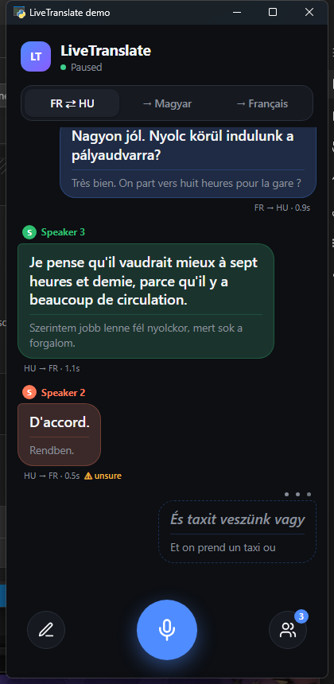

# LiveTranslate

Offline, real-time speech translation between **French and Hungarian**, presented as a chat:
each person gets their own colour, the translation is shown large and the original underneath.



- Speech recognition: Whisper large-v3-turbo · Translation: NLLB-200 · Speakers: WavLM voice prints
- Everything runs on your own machine. No internet needed once the models are downloaded.
- Modes: FR ⇄ HU (auto-detected), any language → Magyar, any language → Français.
- People panel: rename speakers, merge two speakers who are the same person, adjust voice matching.

The desktop app (`desktop/`) works today on Windows with an NVIDIA GPU. An iPhone version is
planned: see [docs/IOS_PORT.md](docs/IOS_PORT.md).

## Run it (Windows + NVIDIA GPU)

```powershell
cd desktop
.\setup.ps1            # once: creates the Python environment (on D:\ by default, see the script)
.\run.cmd              # starts the app; the first start downloads ~9 GB of models
```

Press the microphone button (or Space) and talk. If the wrong microphone is used:
`run.cmd --list-devices`, then `run.cmd --input-device <number>`.

## Run it (macOS, Apple Silicon): untested

```bash
cd desktop && ./setup.sh && ./run.sh
```

## More

- How it works and all tuning parameters: [docs/ARCHITECTURE.md](docs/ARCHITECTURE.md)
- Notes for developers and coding agents: [CLAUDE.md](CLAUDE.md)
- NLLB-200 weights are licensed CC-BY-NC 4.0 (non-commercial use only).
